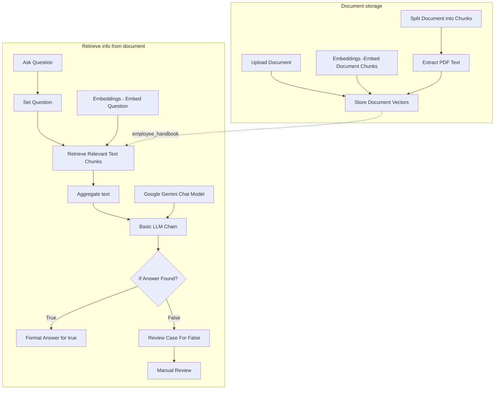

# Document RAG Assistant

An n8n RAG workflow that answers questions from a PDF employee handbook using vector retrieval and Gemini. Questions that cannot be answered from the retrieved context are routed to manual review.

## How It Works

1. Upload a PDF document.
2. Extract and split the document into chunks.
3. Create embeddings and store the chunks in a vector store.
4. Embed the user question and retrieve the most relevant chunks.
5. Aggregate the retrieved context and send it to Gemini.
6. Return a source-grounded answer when the information is found.
7. Route unanswered questions to a manual-review Data Table.

## Key Features

- PDF document ingestion
- Document chunking and embeddings
- Vector similarity retrieval
- Gemini-based question answering
- Source-grounded responses
- `FOUND` / `NOT_FOUND` handling
- Manual-review fallback for unanswered questions

## Example Tests

**Found**
- Meal allowance
- Annual leave entitlement
- Working abroad policy

**Not found**
- Company pension contribution percentage → routed to `needs_review`

# Workflow Architecture

